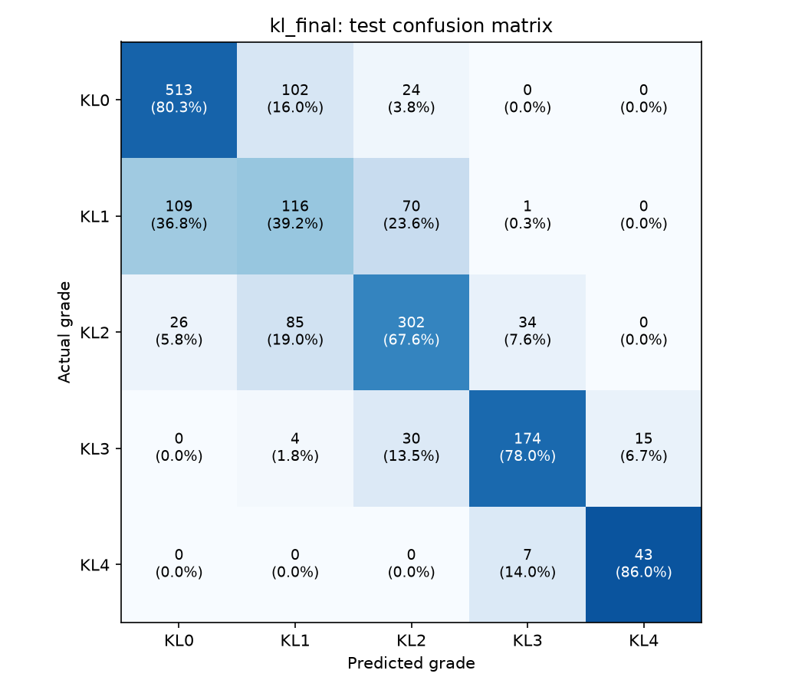

# KL-Grade Classifier — Summary

Final write-up of the backbone comparison, ablation study, and locked final model.
Produced by an unattended overnight run (see `overnight_log.md` for the full decision log,
including a bug caught and fixed mid-run). All model selection used validation QWK only;
the test set was touched exactly once, in Step 4.

## 1. Backbone comparison

Four ImageNet-pretrained backbones, image-only (no mask channel), trained with the original
recipe (class-weighted CE, AdamW 3e-4 + cosine, early stopping on val QWK, patience 6, max 25
epochs). Each run with 3 seeds (42, 7, 123) to check stability:

| Backbone | Mean val QWK | Std | Mean val Acc | Mean val Macro F1 | Params |
|---|---|---|---|---|---|
| efficientnet_b0 | 0.8078 | ±0.0031 | 0.6303 | 0.6656 | 4.0M |
| resnet50 (1 seed only) | 0.8179 | — | 0.6513 | 0.6763 | 23.5M |
| densenet121 (1 seed only) | 0.8228 | — | 0.6695 | 0.6574 | 7.0M |
| **convnext_tiny** | **0.8187** | ±0.0110 | 0.6429 | 0.6780 | 27.8M |

convnext_tiny won on mean QWK across 3 seeds, but with ~3.5x efficientnet_b0's seed variance
(std 0.011 vs 0.003) — its single-seed Step 1 result (0.8312) was partly a favorable draw.
resnet50/densenet121 were only run once each (not part of the 3-seed check, which focused on
the top-2 single-seed performers); picked convnext_tiny anyway since it won the seed-robust
comparison that mattered.

### Warmup check
2 epochs of linear LR warmup before the cosine schedule, on convnext_tiny: 0.8315 vs 0.8312
without warmup (effectively a tie, warmup marginally ahead) — **kept**, since it also visibly
reduced early-training instability (epoch-1 QWK 0.51→0.73, epoch-3 dip 0.43→0.59).

## 2. Ablation study

Starting from convnext_tiny + 2-epoch warmup, each change tested on top of the current best
config, 2 seeds (42, 7), mean val QWK decides adoption:

| Configuration | Val QWK (mean±std) | Val Acc | Val MAE | KL0 recall | KL1 precision | KL3 recall | KL4 recall | Adopted |
|---|---|---|---|---|---|---|---|---|
| Step 1 setup (convnext_tiny+warmup2) | 0.8286±0.0029 | 0.6701 | 0.3759 | 0.7317 | 0.3661 | 0.7594 | 0.9074 | starting row |
| +CLAHE | 0.8340±0.0007 | 0.6834 | 0.3668 | 0.7683 | 0.3856 | 0.7972 | 0.9444 | **yes** |
| +CBAM | 0.8368±0.0066 | 0.6707 | 0.3699 | 0.7088 | 0.3622 | 0.7830 | 0.9444 | **yes** |
| +CORAL | **0.8416±0.0010** | 0.6822 | 0.3638 | 0.8049 | 0.3714 | 0.7924 | 0.9259 | **yes** |
| +class-weights sqrt | 0.8346±0.0000 | 0.6544 | 0.3838 | 0.7668 | 0.3236 | 0.6557 | 0.9630 | no |
| +TTA (eval-only) | 0.8363±0.0023 | 0.6725 | 0.3753 | 0.7850 | 0.3544 | 0.7736 | 0.9444 | no |

**Adopted: CLAHE + CBAM + CORAL** (inverse class weights, no TTA). Final ablation mean QWK
0.8416, up from the 0.8286 starting point.

- **CLAHE** adopted: clear, low-variance improvement (+0.0054 mean, std actually *shrank* to
  0.0007 — contrast normalization made training more consistent, not just better on average).
- **CBAM** adopted: +0.0028 mean, though seed7's CBAM run (0.8302) was slightly below
  CLAHE-alone's seed7 (0.8347) — adopted per the mean rule as instructed, but this is a real
  reminder that CBAM adds seed sensitivity on top of CLAHE's gain.
- **CORAL** adopted: the strongest single gain (+0.0048 mean, and the best KL0 recall of any
  row at 0.8049). Its seed-42 run was still improving at the final epoch (25/25) when training
  stopped on the fixed epoch budget, not early stopping — more epochs might help further, not
  explored here since the epoch budget was kept fixed per the brief.
- **class-weights sqrt** rejected: hurt both seeds enough to drag the mean below CORAL alone,
  and specifically devastated KL3 recall (0.6557 vs 0.7924) in exchange for already-strong
  KL4 recall — a bad trade given KL3/KL4 recall are both clinically important.
- **TTA** rejected: hurt on both seeds. Likely explanation: horizontal flip on a knee X-ray
  swaps medial/lateral anatomy, which isn't a harmless symmetry the way it would be for most
  photographs — flip-averaging blends in a genuinely different anatomical view.

CBAM spatial attention maps for 10 val images (2 per grade) saved to `outputs/results/cbam_maps/`.

## 3. Final architecture

**One-line pipeline**: grayscale X-ray → CLAHE (clipLimit 2.0, 8×8 tiles) → convnext_tiny
(ImageNet-pretrained) → CBAM (channel + spatial attention) on the final feature map → CORAL
ordinal head (4 binary "grade>k" outputs, inverse-frequency pos_weight per threshold) →
predicted grade = count of thresholds with sigmoid output > 0.5.

Of the two seed runs at this configuration, seed 42 (val QWK 0.8425) beat seed 7 (0.8406) and
was saved as the final checkpoint: `outputs/checkpoints/kl_final_best.pt`, with every option
recorded in `outputs/checkpoints/kl_final_config.json`.

## 4. Final test results

Evaluated once, on the untouched 1,655-image test set:

| Metric | kl_baseline (EfficientNet-B0, image-only) | **kl_final** |
|---|---|---|
| Accuracy | 0.6284 | **0.6937** |
| QWK | 0.8246 | **0.8570** |
| Macro F1 | 0.6746 | **0.6926** |
| MAE | 0.4036 | **0.3396** |

Per-grade (kl_final): KL0 P0.792/R0.803/F0.797, KL1 P0.378/R0.392/F0.385, KL2 P0.709/R0.676/F0.692,
KL3 P0.806/R0.780/F0.793, KL4 P0.741/R0.860/F0.796. Full table: `final_test_report.csv`.
Per-image predictions: `kl_final_test_predictions.csv`.

### Confusion matrix

### Statistical significance (paired bootstrap, 2,000 resamples, seed 42)
| Metric | Mean diff (final − baseline) | 95% CI | Significant |
|---|---|---|---|
| QWK | +0.0324 | [0.0174, 0.0478] | **Yes** |
| Accuracy | +0.0653 | [0.0399, 0.0918] | **Yes** |

Both the QWK and accuracy gains are statistically significant at the 95% level (confidence
intervals exclude 0). Full table: `significance_final_vs_baseline.csv`.

KL1 ("doubtful OA") remains the weakest class for both models — a known, clinically subjective
boundary (even radiologists disagree here), not something either architecture resolved.

## 5. Wired into predict.py

`python scripts/predict.py` now defaults to `--run final` (CLAHE + CBAM + CORAL decode applied
automatically). `--run baseline|unet|unetpp` still work unchanged (verified byte-identical
predictions to before this work). `--auto-crop` composes correctly with `--run final`.
